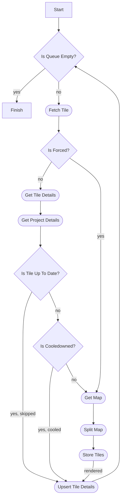

# Retiler


----------------------------------
Tiles for rendering will be consumed from a job queue, currently using [pgboss](https://github.com/timgit/pg-boss).

Each tile holds a `metatile` value and `ZXY` postition. typically a consumed tile will be a square metatile of 8x8 normal tiles (64 tiles), meaning covering a square area of 2048x2048 pixels.

The initial metatile image will be requested for rendering from a map provider service (wms or arcgis), for instance on arcgis, by using the [export map operation](http://sampleserver1.arcgisonline.com/arcgis/sdk/rest/export.html), the request of a large area for rendering e.g. 2048x2048 pixels is more efficient than 64 requests of 256x256.

The fetched metatile image will be splitted into 256x256 pixels tiles in a PNG format and finally will be stored on s3 storage.

## How it works


## config
`app.queueName`: the job queue name to consume tiles from

`app.jobQueue.noSupervisor`: flag for maintenance and monitoring operations on the job queue. defaults to true (meaning no supervision)

`app.map.provider`: the map provider type, wms, arcgis or shigola. see [Shigola mode](#shigola-mode)

`app.map.url`: the url of the map provider service to fetch the map from

`app.map.client.timeoutMs`: the timeout in ms for a fetch map request. defaults to 60000

`app.map.wms.version`: wms service version, 1.1.1 or 1.3.0

`app.map.wms.layers`: layers to display on map, a comma-separated list of layer names

`app.map.wms.styles`: styles in which layers are to be rendered, a comma-separated list of style names

`app.tilesStorage.providers`: an array of tile storage destinations of type `s3` or `fs`, schema is the following:
- for `s3` type:
```json
{
    "type": "s3",
    "endpoint": "s3-endpoint",
    "bucketName": "s3-bucket-name",
    "region": "s3-region",
    "forcePathStyle": "boolean flag",
    "credentials": {
        "accessKeyId": "s3 access-key-id",
        "secretAccessKey": "s3 secret-access-key"
    }
}
```

- for `fs` type:
```json
{
    "type": "fs",
    "basePath": "local tile storage destination path"
}
```

`app.tilesStorage.layout.format`: the format of the tile's key in the storage bucket, the z, x, y values of the tile can be retrieved to the key. defaults to `prefix/{z}/{x}/{y}.png`
e.g. `prefix/{z}/{x}/{y}.png` formated to the tile
```json
{ z: 3, x: 10, y: 4 }
```
will result in the key: "prefix/3/10/4.png"

`app.tilesStorage.layout.shouldFlipY`: determine if the key value of y (formatted by `app.tilesStorage.layout.format`) should be flipped over the y axis. e.g. if on the y axis there are overall 8 tiles with y values of 0 through 7 then 0 will be flipped to 7 and 7 to 0, 1 to 6 and 6 to 1 and so on. defaults to true

`app.tilesStorage.shouldFilterBlankTiles`: determine if tiles or their sub-tiles will not be storaged on configured providers if found as blanked

## Shigola mode

With `app.map.provider` set to `shigola`, retiler keeps [shigola](https://github.com/MapColonies/shigola)'s tile cache fresh instead of rendering tiles itself. Each metatile job becomes exactly one request to shigola's Cache Admin API, `POST {app.map.url}/cache/{purge|seed}`, with the metatile's lng/lat bbox and its zoom as both the min and max of the zoom range. Shigola purges or renders the covered tiles in its own cache, so no map is fetched, split or stored: `app.map.wms` and `app.tilesStorage` are unused, and so is detiler, even when enabled.

`app.map.url`: shigola's Cache Admin API, served on its own admin port

`app.map.shigola.operation`: `purge` (default) or `seed`. a seed always sends `"overwrite": true`, and needs a shigola with `POST /cache/seed`

`app.map.shigola.targets`: the shigola maps to work on, as `[{"map": "osm", "layers": ["roads"]}]`. `layers` is optional and only valid for purge, since shigola seeds whole maps only

`app.map.shigola.tileMatrixSets`: optional, work on only these tile matrix sets. omitted, every set each map serves. the zoom sent is the metatile's zoom in WorldCRS84Quad, so `["WorldCRS84Quad"]` (the helm chart's default) keeps each request to exactly the metatile's tiles, while other sets would be refreshed at that zoom number over a different extent

`app.map.shigola.token`: optional, the Cache Admin API bearer token (shigola's `webserver.admin.token`). omitted or empty, no token is sent. the helm chart takes it either as `env.map.shigola.token`, stored in the chart's secret, or from a key of an existing secret with `env.map.shigola.existingSecret.name` and `.key`

`app.map.shigola.timeoutMs`: the request timeout in ms, defaults to 70000. keep it above shigola's `request_timeout_ms` (60000 by default) so shigola's own timeout answer arrives first

Each job ends by the request's outcome:

| response | job | why |
| --- | --- | --- |
| 2xx | completed | shigola answers 500 when a tile fails, so a 2xx is done. any failed count it still reports goes to the tiles metric |
| 4xx other than 401, 403, 404 and 429 (bad bbox, unknown map, too many tiles) | cancelled, never retried | repeating cannot fix it. pg-boss can only fail a fetched job into a retry, so cancel is how it ends without one: the job ends `cancelled`, with the reason in the logs, metrics and trace only |
| 401, 403, 404, 429, 5xx, timeout or connection error | failed, retried by pg-boss | it may pass later, using the queue's retry and backoff settings. a missing or rotated token, or a wrong `app.map.url` (shigola itself never answers 404), is fixed by a deploy, so it is retried rather than losing every metatile meanwhile |

Shigola answers 429 once `max_concurrent_requests` (4 by default) are in flight, so keep `app.parallelism` at or below it across retiler replicas.

Shigola mode has its own metrics and traces:
- `retiler_shigola_requests_count{operation, outcome, code}`: outcome is `completed`, `rejected` (not retried) or `failed` (retried), code the http status or `none`
- `retiler_shigola_tiles_count{operation, result}`: the tiles shigola reported as `done` (purged or seeded), `skipped` or `failed`
- `retiler_shigola_request_duration_seconds{operation, z}`
- a `shigola.cache` span per job, with `shigola.operation`, `shigola.outcome`, `http.response.status_code` and the tile counts

## Run Locally

Clone the project

```bash

git clone https://github.com/MapColonies/retiler.git

```

Go to the project directory

```bash

cd retiler

```

Install dependencies

```bash

npm install

```

Start the server

```bash

npm start

```

## Running Tests

To run tests, run the following command

```bash

npm run test

```

To only run unit tests:
```bash
npm run test:unit
```

To only run integration tests:
```bash
npm run test:integration
```
